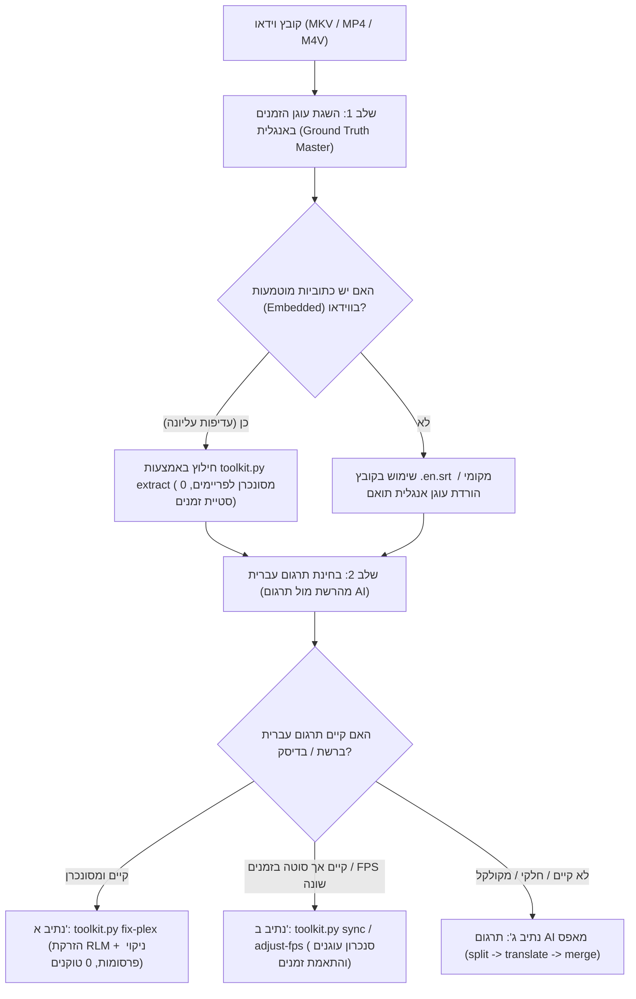
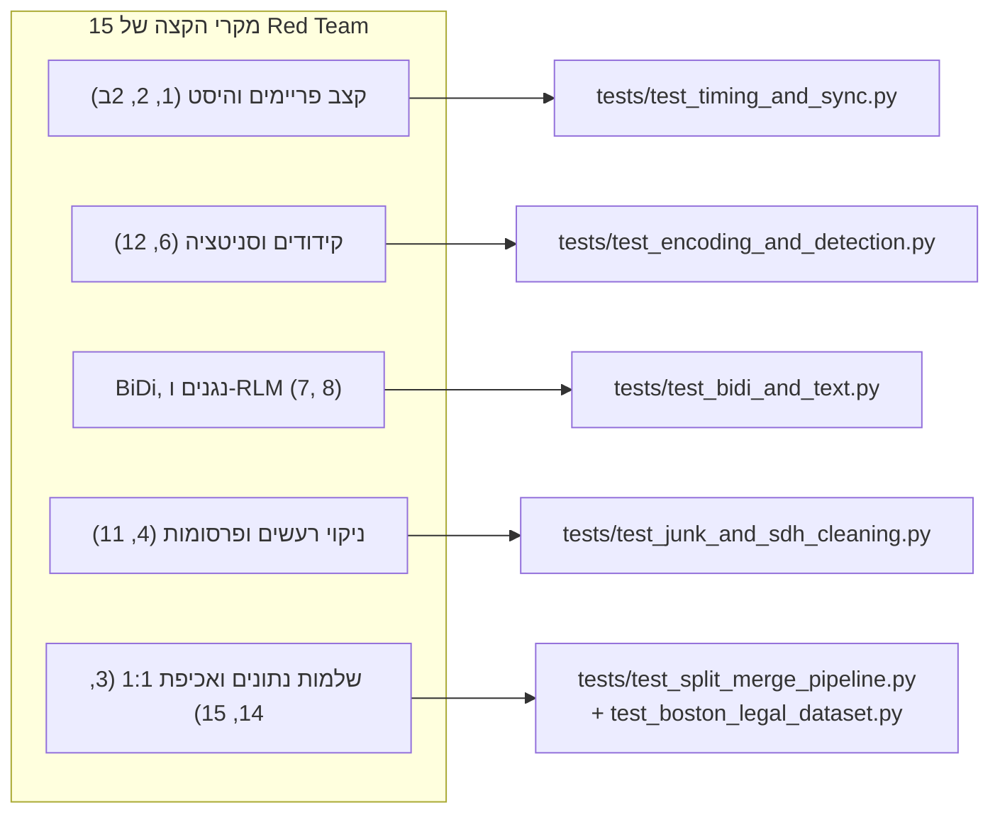

# מקרי קצה, ניתוח סיכונים ותורת ה-Red Team לכתוביות 🛡️
## The Complete Subtitle Edge Cases, Red Team Risk Matrix & Mitigation Guide

מסמך זה מהווה את האנציקלופדיה המלאה והמקיפה לכל מקרי הקיצון, התקלות הפוטנציאליות והפתרונות ההנדסיים בעולם תרגום, סנכרון ורינדור כתוביות לסרטים וסדרות (דגש על נגני Plex, Infuse, VLC וטלוויזיות חכמות).

---

## תוכן העניינים
1. [רובד 1: עץ ההחלטות וההפרדה בין שפת מקור לשפת יעד](#רובד-1-עץ-ההחלטות-וההפרדה-בין-שפת-מקור-לשפת-יעד)
2. [רובד 2: כתוביות לכבדי שמיעה (Closed Captions / SDH)](#רובד-2-כתוביות-לכבדי-שמיעה-closed-captions--sdh)
3. [רובד 3: תאימות נגנים, קידודים ו-BiDi (Plex, Infuse, Tizen, webOS)](#רובד-3-תאימות-נגנים-קידודים-ו-bidi)
4. [רובד 4: ניתוח Red Team – 15 מקרי הקיצון הטכניים וההגנות עליהם](#רובד-4-ניתוח-red-team--15-מקרי-הקיצון-הטכניים-וההגנות-עליהם)
5. [רובד 5: כלי המערכת האוטומטיים לטיפול במקרי הקצה](#רובד-5-כלי-המערכת-האוטומטיים-לטיפול-במקרי-הקצה)

---

## רובד 1: עץ ההחלטות וההפרדה בין שפת מקור לשפת יעד

אחת הטעויות הנפוצות היא ערבוב בין כתוביות המקור (אנגלית) לכתוביות התרגום (עברית). המערכת מגדירה הפרדה מוחלטת:



### כללי ברזל:
* **עוגן האנגלית הוא שעון העצר (Master Clock):** כל דיאלוג, מעבר סצנה וזמן שהייה נמדדים אך ורק מול עוגן האנגלית.
* **כתוביות מוטמעות עדיפות על כתוביות רשת:** כתובית מוטמעת נארזה על ידי האולפן/קבוצת ההפצה ישירות מול רצף ה-PTS של הווידאו, ומכילה את התסריט הרשמי.

---

## רובד 2: כתוביות לכבדי שמיעה (Closed Captions / SDH)

כתוביות מקור רבות (במיוחד מ-Web-DL ו-Blu-ray) הן כתוביות SDH הכוללות תיאורי צליל ורעשים בסוגריים: `[Denny]`, `[LAUGHS]`, `[DOOR SLAMS]`, `(music playing)`.

### החוק הכפול של המערכת (The Dual SDH Rule):
1. **חוק הניקוי (Presentation Cleaning):**
   * אסור להציג תיאורי צלילים לצופה השומע בעברית. ביטויים כמו `[מחיאות כפיים]`, `[נאנח]` או `[דני]` נתפסים כתרגום חובבני וצורם.
   * יש לנקות לחלוטין כל תיאור צליל מהטקסט המוצג.
2. **חוק ההקשר (Context Extraction - אסור למחוק לפני התרגום!):**
   * **ה-SDH הוא מכרה זהב של הקשר (Context).**
   * הוא מוסר למודל את זהות הדובר (`[Denny]`), את הטון (`[whispering]`), ואת הסיטואציה.
   * באמצעות ה-SDH המודל יודע בוודאות האם לפנות בלשון זכר (`אתה`), נקבה (`את`) או רבים (`אתם`), ומונע עיוורון מגדרי.

---

## רובד 3: תאימות נגנים, קידודים ו-BiDi (Plex, Infuse, Tizen, webOS)

### 1. מלכודת ה-BiDi של Plex: היפוך סימני פיסוק
* **הבעיה:** לפי תקן Unicode, סימני פיסוק (נקודה, פסיק, סימן שאלה, סימן קריאה) הם "תווים ניטרליים". Plex מפרש קובצי כתוביות SRT כברירת מחדל LTR (משמאל לימין), ולכן סימן השאלה או הנקודה מוצגים בתחילת השורה בימין במקום בסופה בשמאל.
* **הפתרון האלגנטי:** הזרקת תו יוניקוד בלתי-נראה **RLM** (`\u200F` - Right-to-Left Mark) בראש כל שורת כתובית וסמוך לסימני פיסוק. התו מכריח את מנוע הרינדור של Plex ליישר את השורה כ-RTL אמיתי.
* **אי-פגיעה ב-Infuse / VLC:** תו ה-RLM הוא תו תקני בלתי נראה, ונגנים חכמים כמו Infuse ממשיכים להציג את הכתובית ללא שום שינוי או הפרעה.

### 2. קידודי טקסט ישנים (Windows-1255 / ANSI / CP1255)
* **הבעיה:** מאות אלפי קובצי כתוביות ישנים ברשת שמורים בקידוד עברי של חלונות (`CP1255` או `ISO-8859-8`). בנגנים מודרניים הם מוצגים כסימני שאלה (`????`) או ג'יבריש (`éùøàì`).
* **הפתרון:** זיהוי אוטומטי של חתימת הקידוד והמרה שקופה ל-`UTF-8` נקי עם BOM/ללא BOM.

### 3. אימות שפה מובנה (Language Verification & Auto-Skip)
* כלי התיקון (`fix-plex`) מנתח סטטיסטית את תכולת האותיות העבריות (`\u0590-\u05FF`) מול לטיניות.
* אם קובץ הוא באנגלית או שפה זרה – הכלי מדלג עליו מיד (`[SKIP] Not Hebrew`) כדי למנוע השחתה או הזרקת RLM לקובץ לועזי.

### 4. הגנה על תגיות עיצוב (`<i>`, `<b>`, `<u>`, `{\an8}`)
* כתוביות רבות כוללות תגיות HTML (`<i>טקסט</i>`) או תגי מיקום של ASS (`{\an8}`).
* הזרקת RLM שגויה עלולה להפריד בין התגית לתוכן (`<i>\u200Fטקסט`) ולגרום לנגן להציג את התגית כטקסט גלוי על המסך. הכלי מוודא שה-RLM מוזרק לפני התגית הפותחת או אחריה בצורה שלא שוברת את ה-DOM של הנגן.

---

## רובד 4: ניתוח Red Team – 15 מקרי הקיצון הטכניים וההגנות עליהם

### שכבה א': קונטיינר ומולטימדיה (The Media & Container Layer)

#### 1. קצב פריימים משתנה (Variable Frame Rate - VFR)
* **הסכנה:** קובץ וידאו שקצב הפריימים שלו מתנודד בזמן אמת (למשל 22 עד 24.5 FPS).
* **הכשל:** מתיחה לינארית קבועה נכשלת (סנכרון בהתחלה, פיגור באמצע, הקדמה בסוף).
* **ההגנה:** זיהוי VFR ב-`ffprobe` והמרת הקונטיינר ל-CFR ב-0 איבוד איכות:
  ```bash
  ffmpeg -i input.mp4 -vsync cfr -c:v copy -c:a copy output_cfr.mp4
  ```

#### 2. פערי פרסומות וקדימונים (Commercial Cuts & "Previously On")
* **הסכנה:** כתובית שידור הכוללת קדימון של 30 שניות שאינו קיים בווידאו, או מסכים שחורים קצרים שנחתכו בין מקטעים.
* **ההגנה:** סנכרון עוגנים (Anchor Sync) לפי שיר הפתיחה או נקודת המעבר הראשונה.

#### 2ב. דיליי קבוע והקדמת כתוביות מובנית במהדורות DVD ו-Broadcast (The Lead-in / Audio-Offset Trap)
* **התופעה:** במהדורות DVD, Web-DL ישנות או שידורי טלוויזיה, מחברי הכתוביות באולפן מגדירים לעיתים במכוון "Lead-in Time" שבו הכתובית מופיעה בין 200 ל-600 מילי-שניות *לפני* שהשחקן מתחיל להניע את השפתיים (כדי לאפשר לצופה להתחיל לקרוא מראש). לחלופין, בעת לכידת שידור או המרת DVD נוצר היסט זמנים קבוע (Constant Offset) בין רצועת הווידאו לרצועת הכתוביות.
* **הכשל התפיסתי:** לצופה זה נראה כאילו התרגום "ממהר" ואינו מסונכרן לדיבור, על אף שהעברית מותאמת ב-100% למקור האנגלי של האולפן.
* **האבחון והפתרון:**
  1. **אבחון מהיר:** אם כתוביות המקור באנגלית מופיעות מוקדם בדיוק באותו אופן, מקור הפער הוא במהדורה עצמה (DVD/Broadcast Master).
  2. **תיקון גלובלי מדויק של היסט זמנים:** שימוש בפקודת `adjust-fps` עם דגל `--offset_ms` לעיכוב כל כתוביות הפרק בערך קבוע (למשל 350 מילי-שניות קדימה):
  ```bash
  python3 toolkit.py adjust-fps "Boston Legal S01E01.he.srt" -o "Boston Legal S01E01.he.srt" --offset_ms 350
  ```
  הפקודה מזיזה את כל חותמות הזמן קדימה או אחורה בדיוק של מילי-שנייה בודדת ומביאה להתאמת שפתיים (Lip-Sync) מושלמת.

#### 3. כתוביות חופפות בזמן (Overlapping / Colliding Cues)
* **הסכנה:** כתובית A מסתיימת ב-`00:01:10,500` וכתובית B מתחילה ב-`00:01:10,200` (חפיפה של 300ms).
* **הכשל:** הבהוב (Flicker) או היעלמות של אחת הכתוביות בטלוויזיות חכמות (LG, Samsung).
* **ההגנה:** Clamping אוטומטי בסקריפט המיזוג:
  `if cues[i].end > cues[i+1].start: cues[i].end = cues[i+1].start - timedelta(milliseconds=20)`

#### 4. כתוביות רפאים ואורך אפס (Zero-Duration / Ghost Cues)
* **הסכנה:** כתוביות עם משך קצר מ-200ms או `start >= end`.
* **ההגנה:** סינון אוטומטי של כתוביות פגומות שאינן ניתנות לקריאה.

#### 5. ערוצי כתוביות מרובים (Multi-Stream Ambiguity)
* **הסכנה:** וידאו המכיל ערוץ דיאלוג ראשי, ערוץ SDH, ערוץ הערות במאי (Commentary), וערוץ "Forced" לחלקים זרים.
* **ההגנה:** סריקת `disposition` ומטא-דאטה של הערוצים ב-`ffprobe` לבחירת ערוץ הדיאלוג המלא (ולא הערות במאי).

---

### שכבה ב': רינדור, כיווניות ו-BiDi

#### 6. תגיות עיצוב שבורות או הפוכות
* **הסכנה:** כתוביות המכילות תגיות `<i>` שלא נסגרו או נסגרו בצורה שגויה (`<i/>`) בגלל היפוך עברית.
* **ההגנה:** סגירה וסניטציה אוטומטית של תגיות HTML ב-Python.

#### 7. היפוך מירכאות, סוגריים ו-18 תבניות Visual Pre-Flipping היסטוריות (Smart TV & Legacy Flipper Recovery)
* **הסכנה הכפולה:**
  1. בטלוויזיות חכמות (Tizen, webOS) ובנגנים המניחים פסקת LTR, סוגריים וסימני פיסוק בסוף שורה קופצים לתחילת המשפט בימין אם ה-`RLM` אינו מוצב **אחרי** סימן הפיסוק לפי תקן **UAX #9 Rule N1** (`R + N + R` $\rightarrow$ `R`).
  2. סריקת עומק של **20,299 קובצי כתוביות (`14,752` קבצים בעברית / `15,630,175` שורות)** חשפה כי אלפי כתוביות מהרשת עברו בעבר "היפוך פיסוק ויזואלי" (`Subabi` / `SubsCenter`) שבו הנקודה, סימן השאלה, המקף או הסוגריים הוזזו פיזית לתחילת המחרוזת הלוגית (`.שלום`, `-.שלום`, `.מה שלומך-`, `(שלום(`, `.1999 בשנת`). הזרקת `RLM` עיוורת על קובץ כזה נועלת את השיבוש לנצח!
* **ההגנה (מנוע ה-BiDi התלת-שלבי ב-`07_fix_plex_punctuation.py`):**
  1. `detect_file_flip_polarity(content)`: זיהוי קוטביות ברמת הקובץ כדי להבחין בין קובץ לוגי תקין לבין קובץ שעבר היפוך ויזואלי.
  2. `canonicalize_visual_flipped_line(core, is_preflipped_file)`: היפוך דטרמיניסטי של כל **18 תבניות השיבוש הוויזואלי** חזרה לעברית לוגית קנונית לפני הזרקת `RLM`.
  3. עטיפת הליבה הלוגית ב-`RLM` מוביל וב-`RLM` סוגר **אחרי** סימן הפיסוק (`\u200Fשלום!\u200F`), בתוספת `RLM` פנימי לפני פיסוק סופי רק כאשר המילה האחרונה היא באנגלית (`ראיתי את ה-FBI\u200F.\u200F`).

#### 8. מספרים, תאריכים, מילים לועזיות ואותיות סופיות (BiDi Number Mangles & Final-Letter Safety)
* **הסכנה:**
  1. ביטויים כמו `-$500` או `2004-2008` שבהם המינוס קופץ לסוף.
  2. נרמול אגרסיבי של אותיות סופיות (`מ` $\rightarrow$ `ם`, `פ` $\rightarrow$ `ף`) בסוף מילה עלול להשחית קריאות היסוס תקניות (`אממ` $\rightarrow$ `אמם`, `הממ` $\rightarrow$ `המם`, `מממ` $\rightarrow$ `ממם`) ומילים לועזיות (`טרמפ` $\rightarrow$ `טרמף`, `ג'יפ` $\rightarrow$ `ג'יף`). מנגד, הסרת ניקוד מהמילה התקנית `אִמם` ("אימא שלהם", למשל בצירוף `אביהם וגם אִמם`) יוצרת `אמם` זהה ויזואלית!
* **ההגנה:**
  1. ניסוח מילולי עברי טבעי למספרים, והגנת `.1999 בשנת` $\rightarrow$ `בשנת 1999.`.
  2. הפעלת `normalize_final_letters` **אך ורק כאשר הוחלף בפועל תו הומוגליף זר** (קירילי/ערבי) באותה שורה (`if had_homoglyph:`), המרת `אִמם` מנוקדת לכתיב מלא תקני `אימם` לפני הסרת הניקוד, ותיקון אוטומטי של `אמם`/`המם`/`ממם`/`טרמף` חזרה ל-`אממ`/`הממ`/`מממ`/`טרמפ`.

---

### שכבה ג': לשון, הקשר ועיוורון מגדרי

#### 9. עיוורון מגדרי לדמויות מחוץ למסך ופניות בסוף משפט (Off-Screen Gender & Trailing Vocatives)
* **הסכנה:** פנייה לדמות שאינה בפריים ("I'm proud of you") או פנייה שבה שם הדמות מופיע בסוף המשפט (`"אתה מוכן, שירלי?"`, `"תן לי לומר לך משהו, שירלי."`, `"אל תגידי לי להירגע, דני!"`) או סתירה פנימית באותה שורה (`"אתה ובעלך?"`, `"אלוהים אדיבים"`).
* **ההגנה:**
  1. בניית מילון דוברים (`translation_bible.json`) המגדיר מראש את מין הדמויות.
  2. בדיקת QA דו-כיוונית ב-`08_quality_assurance.py` המזהה הן פניות מובילות (`שירלי, אתה מוכן?`), הן פניות סוגרות (`תן לי לומר לך משהו, שירלי.`), והן סתירות מורפולוגיות פנימיות (`אתה ובעלך`).

#### 10. מילים הומוגרפיות בז'רגון מקצועי (Contextual Homographs)
* **הסכנה:** מילים בעלות משמעות שונה לחלוטין בתחום המשפטי / הרפואי לעומת שיחה רגילה:
  * `Brief` -> כתב טענות (משפטי) ולא "תחתונים" / "קצר".
  * `Bench` -> כס השיפוט ולא "ספסל".
  * `Bar` -> לשכת עורכי הדין ולא "פאב" / "מוט".
  * `Suit` -> תביעה משפטית ולא "חליפה".
  * `Plant` -> מפעל / מתקן ולא "צמח".
  * `Gross` -> ברוטו ולא "מגעיל".
* **ההגנה:** נעילת מילון מונחים (Locked Glossary) המוזרק לפרומפט המתרגם.

#### 11. ביטויים בלטינית ושפות זרות
* **הסכנה:** תרגום מילולי מעוות של ביטויים לטיניים (*habeas corpus* -> "שתהיה לך גופה").
* **ההגנה:** תעתיק עברי מקצועי מקובל: *הביאס קורפוס / צו הבאת עציר*, *פרו בונו*, *מנס ראה*.

#### 12. שירים מול דיאלוגים (`♪`) וקרדיטים דו-שורתיים (Multi-Line Credits)
* **הסכנה:**
  1. מילות שיר ברקע שמתערבבות עם דיאלוג השחקנים או מאבדות את תו ה-`♪`.
  2. קרדיט מתרגמים המתפרס על שתי שורות (`"<i>הובא וסונכרן על ידי\nאריאל אפרתי</i>"`), שבו ניקוי השורה הראשונה בלבד משאיר את שם המתרגם כ"דיאלוג יתום" בפרק.
* **ההגנה:** הפרדה שורתית ברורה עם שימור `♪`, ומסנן בלוקים (`_filter_ad_lines_from_block`) המזהה פתיח קרדיט בשורה הראשונה ומוחק גם את שורת השם המשלימה תוך שימור דיאלוג אמיתי בבלוקים מעורבים.

---

### שכבה ד': מודלי שפה, מערכות ו-API

#### 13. חסימות מסנני בטיחות (Safety Filters / Silent Drops)
* **הסכנה:** דיאלוג המכיל תיאורי פשע, אונס או קללות בבית משפט עלול לגרום למודל לחסום את המנה ולהשמיט 200 כתוביות.
* **ההגנה:** הצהרת הקשר בפרומפט המערכת: *"Official cultural localization of broadcast drama for accessibility"*, ומנגנון זיהוי חסרים וחלוקה לתת-מנות.

#### 14. עקביות שמות וכינויים בין מנות (Cross-Batch Name Drifts)
* **הסכנה:** במנה 1 הדמות נקראת "מתוקה" ובמנה 2 "יקירתי".
* **ההגנה:** הזרקת ה-Bible לכל מנה ומנה בנפרד ללא תלות בסדר הריצה.

#### 15. חריגת מגבלת טוקנים והיסט שורות שקט בין קיוסים (Token Truncation & Cue Drift)
* **הסכנה:**
  1. משלוח של 400 כתוביות בבת אחת עלול לחצות את תקרת הפלט של המודל (8,192 טוקנים) ולקטוע את ה-JSON באמצע.
  2. מודל שפה עלול לאחד שתי כתוביות קצרות לכתובית אחת ולהוסיף שורה כפולה בהמשך כדי לשמור על אותו מספר אינדקסים (`len(en) == len(he)`), מה שיוצר **סטיית סנכרון שקטה (`Cue Drift`) של `+1` או `-1`** לאורך עשרות שורות!
* **ההגנה:**
  1. הגבלה מוחלטת של גודל מנה ל-**200 עד 225 כתוביות לכל היותר** (~4,500 טוקנים).
  2. פונקציית אימות עוגנים `validate_anchor_alignment(en_texts, he_translations)` ב-`05_merge_and_validate.py`, המשווה את חתימת סימני השאלה (`?`), תווי המוזיקה (`♪`) והמספרים בחלונות של 25 כתוביות מול היסטים של `-2, -1, 0, +1, +2` ומתריעה מיד על כל סטיית `Cue Drift`.

---

## רובד 5: כלי המערכת האוטומטיים לטיפול במקרי הקצה

כל מקרי הקצה הנ"ל מכוסים באופן ישיר בקוד באמצעות הפקודות של `toolkit.py`:

| פקודה | מקרי קצה שמטופלים |
| :--- | :--- |
| `toolkit.py extract` | גילוי אוטונומי, קדימות כתוביות מוטמעות (Embedded-First), סניטציית תגיות `<font>`, המרת VTT/ASS ל-SRT. |
| `toolkit.py fix-plex` | היפוך סימני פיסוק בפלקס (RLM), אימות שפה (דילוג על אנגלית), פענוח קידוד Windows-1255, ניקוי פרסומות, גיבוי ו-Dry-Run. |
| `toolkit.py bible` | מניעת עיוורון מגדרי, נעילת מילון מונחים משפטי, ביטויים בלטינית והומוגרפים. |
| `toolkit.py split` | הגבלת מנות ל-~210 כתוביות למניעת חריגת טוקנים (Token Truncation) ופגיעה במכסות. |
| `toolkit.py merge` | אימות 1:1, מניעת כתוביות חופפות (Clamping), סגירת תגיות עיצוב, והזרקת תווי RLM. |
| `toolkit.py adjust-fps` | פתרון פער פריימים (23.976 <-> 25.0 FPS) והזזת היסט זמנים (Offset). |
| `toolkit.py sync` | בדיקת דלתא והתאמת זמנים בין תרגום רשת קיים לעוגן האנגלית המוטמע. |

---

## רובד 6: מטריצת בדיקות אוטומטיות (Pytest Test Matrix for Red Team)

כדי להבטיח ששום מקרה קצה לא יישבר או יסבול מרגרסיה בעתיד, כל מקרי הקיצון מופו ישירות לבדיקות יחידה ואינטגרציה בתוך `tests/`:



| # | מקרה קצה (Red Team Edge Case) | קובץ הבדיקה ב-Pytest | פונקציית הבדיקה (Test Function) | תוצאה |
| :---: | :--- | :--- | :--- | :---: |
| **1** | מתיחת קצב פריימים (23.976 <-> 25.0 FPS) | `tests/test_timing_and_sync.py` | `test_fps_conversion_ratio` | **PASSED** |
| **2** | היסט זמנים ו-Lead-in (הזזת מילי-שניות) | `tests/test_timing_and_sync.py` | `test_offset_addition_and_subtraction` | **PASSED** |
| **3** | כתוביות רפאים ומשך זמן שלילי | `tests/test_timing_and_sync.py` | `test_zero_time_clamping` | **PASSED** |
| **4** | היפוך סימני פיסוק בפלקס (RLM בסוף שורה) | `tests/test_bidi_and_text.py` | `test_apply_rlm_trailing_punctuation` | **PASSED** |
| **5** | סימני שאלה וקריאה עבריים | `tests/test_bidi_and_text.py` | `test_apply_rlm_question_and_exclamation` | **PASSED** |
| **6** | גרשיים עבריים בראשי תיבות (`״` במקום `"`) | `tests/test_bidi_and_text.py` | `test_gershayim_conversion_for_acronyms` | **PASSED** |
| **7** | שמירה על תגיות HTML (`<i>`, `<font>`) ותגי מיקום (`{\an8}`) | `tests/test_bidi_and_text.py` | `test_ssa_override_tag_preservation`, `test_html_font_and_nested_tags_preservation` | **PASSED** |
| **8** | מניעת כפילויות RLM (אידמפוטנטיות) ומקפי דיאלוג באנגלית | `tests/test_bidi_and_text.py` | `test_idempotency_no_duplicate_rlm`, `test_dialogue_hyphen_with_english_word_bidi` | **PASSED** |
| **9** | ניקוי מקפים יתומים ושימור מילים לועזיות ב-`פ` סופית (`ג'יפ`, `קטשופ`) | `tests/test_bidi_and_text.py` | `test_orphaned_hyphens_filtering`, `test_loanword_pe_and_single_letter_preserved` | **PASSED** |
| **10** | פענוח קידוד Windows-1255 ו-UTF-16 BOM ל-UTF-8 | `tests/test_encoding_and_detection.py` | `test_windows_1255_conversion`, `test_utf16_bom_detection` | **PASSED** |
| **11** | אימות שפה והבחנה בין CP1255 עברי ל-CP1252 אירופאי ו-UTF-8 (`0xE2`) | `tests/test_encoding_and_detection.py` | `test_windows_1252_european_not_misidentified_as_hebrew`, `test_utf8_english_with_3byte_punctuation_not_corrupted` | **PASSED** |
| **12** | ניקוי פרסומות וקרדיטים תוך שימור דיאלוג באותו בלוק ומשפטים עם נקודתיים | `tests/test_junk_and_sdh_cleaning.py` | `test_promo_and_ad_detection`, `test_mid_sentence_colon_not_flagged_as_ad`, `test_partial_cue_ad_stripping_preserves_dialogue` | **PASSED** |
| **13** | סינון תיאורי רעש ומוזיקה לכבדי שמיעה (SDH) | `tests/test_junk_and_sdh_cleaning.py` | `test_sdh_sound_pattern_matching` | **PASSED** |
| **14** | התרעה קריטית על כתובית חסרה, תיקון חפיפות זמנים וסינון ערוצי PGS/Bitmap | `tests/test_split_merge_pipeline.py` | `test_merge_fails_loudly_on_missing_index`, `test_merge_clamps_overlapping_timestamps`, `test_extract_filters_bitmap_subtitle_streams` | **PASSED** |
| **15** | אבטחת שרת Webhook: קדימות `PATH_MAP`, מניעת Path Traversal, תקרת 2MB (413) ונעילה מקבילית | `tests/test_webhook_server.py` | `test_path_map_longest_prefix_precedence_and_traversal_guard`, `test_oversized_payload_returns_413`, `test_concurrent_webhook_requests_thread_safety` | **PASSED** |
| **16** | הומוגליף גאורגי (`דეייט` $\rightarrow$ `דייט`) והיפוך מספרים דו-לשוני (`cross_check_bilingual_numbers`, `84` $\rightarrow$ `48`) | `tests/test_bidi_and_text.py`, `tests/test_polish_and_qc.py` | `test_georgian_eni_homoglyph_in_date_word`, `test_bilingual_number_unflipping_in_polish` | **PASSED** |
| **17** | זיהוי קובצי `.srt` עבריים לפי תוכן ושמירה במצב Seed-Safe (`.srt` $\rightarrow$ `.he.srt`) להגנת טורנטים | `tests/test_auto_and_ollama.py`, `tests/test_polish_and_qc.py` | `test_auto_seed_safe_plain_srt_to_he_srt`, `test_polish_seed_safe_plain_srt_to_he_srt` | **PASSED** |
| **18** | שרת MCP מובנה (`rightsub mcp`): בידוד `stdout` (`_isolated_stdio`), מסגור כפול (`Content-Length` + JSONL) והתקנה מרובת-סוכנים | `tests/test_mcp_server.py` | `test_stdout_isolation_prevents_jsonrpc_pollution`, `test_content_length_and_jsonl_framing`, `test_install_and_uninstall_mcp_agents` | **PASSED** |
| **19** | אשף CLI אינטראקטיבי (`rightsub`): הגנת Non-TTY לצינורות CI, נרמול נתיבי Drag & Drop ומבקר `polish --interactive` | `tests/test_interactive_wizard.py` | `test_no_args_non_tty_prints_help_without_hanging`, `test_normalize_dragged_path_variants`, `test_interactive_review_modifications` | **PASSED** |


