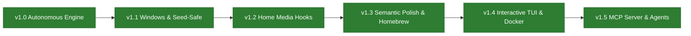

# 🗺️ RightSub Product Roadmap & Milestone Tracker

  <b>Language / שפה:</b>
  <b>English</b> |
  <a href="ROADMAP.he.md"><b>עברית</b></a>

Welcome to the official **RightSub Product Roadmap**. This document outlines delivered milestones, active priorities, and future architectural initiatives for the RightSub universal subtitle mastering and translation suite.

---

## 🧭 Milestone Progression Overview

---

## 🟢 Shipped Milestones (Production Stable)

### 🌟 [v1.5.0](https://github.com/omerninyo/RightSub/releases/tag/v1.5.0) — Native MCP Server, Multi-Agent Auto-Installer & Unified Interactive Suite
> **Released:** October 2026  
> **Primary RFC:** [RFC 002: RightSub Native Model Context Protocol (MCP) Server](docs/proposals/RFC_002_MCP_SERVER.md)  
> **Key Capabilities:**
- [x] **Official MCP Server (`rightsub mcp`)** ([#3](https://github.com/omerninyo/RightSub/issues/3)):
  - Zero-dependency JSON-RPC 2.0 server over `stdio` (supporting both newline-delimited JSON and `Content-Length` framing) with strict `stdout` log isolation.
  - Exposes 8 tools: `inspect_media`, `fix_plex_subtitles`, `extract_subtitles`, `prepare_translation`, `merge_and_master`, `polish_subtitles`, `audit_subtitles_qa`, and `transcribe_audio`.
- [x] **1-Command Multi-Agent Auto-Installer (`rightsub mcp --install`)**:
  - Automatically detects and registers `rightsub` into **Antigravity**, **Claude Desktop**, **Cursor**, **Windsurf**, and **Claude Code** with absolute Python/script paths, full `PATH` environment injection, `.bak` backups, and zero corruption of existing servers.
- [x] **Natural Language Media Control & Batch Orchestration**:
  - Enables any connected AI agent to inspect folders, repair Plex BiDi with Seed-Safe torrent protection, extract tracks, translate batches, and run Red Team QA directly from chat.

### 🌟 [v1.4.0](https://github.com/omerninyo/RightSub/releases/tag/v1.4.0) — Interactive Terminal Experience (TUI), Hooks Wizard & Containers
> **Released:** October 2026  
> **Primary RFCs:**
> - [RFC 001: Interactive Terminal UI (TUI) Specification](docs/proposals/RFC_001_INTERACTIVE_TUI.md)
> - [RFC 003: Autonomous Setup & Health-Check Wizard](docs/proposals/RFC_003_SYSTEM_INTEGRATION_WIZARD.md)
> - [RFC 004: Docker Webhook Daemon & Container Architecture](docs/proposals/RFC_004_DOCKER_WEBHOOK_SERVER.md)
> **Key Capabilities:**
- [x] **Interactive Terminal Mastering Wizard (`rightsub` / `rightsub wizard`) & Diff Reviewer (`rightsub polish --interactive`)** ([#1](https://github.com/omerninyo/RightSub/issues/1)):
  - Running `rightsub` with no arguments in an interactive terminal launches the bilingual Mastering Suite with cross-platform Drag & Drop path normalization (macOS Finder backslash escapes, Windows Explorer quotes, PowerShell `& '...'`) and a built-in terminal file explorer.
  - Line-by-line diff reviewer (`rightsub polish --interactive`) with `[Y] Approve`, `[N] Reject`, `[E] Edit`, `[A] Approve All`, `[R] Reject Remaining`, and `Ctrl+C` partial-save recovery.
- [x] **Automated Downloader Hook Installer & Service Wrapper (`rightsub setup` / `rightsub config --install-hooks`)** ([#2](https://github.com/omerninyo/RightSub/issues/2)):
  - Generates ready-to-run `qBittorrent` (`.sh` / `.bat`) and `Transmission` hook scripts, optional live `Sonarr`/`Radarr` REST API webhook registration, and background service definitions (`launchd` on macOS, `systemd --user` on Linux, `schtasks` on Windows).
- [x] **Official Container Image & Native Webhook Daemon (Docker / Podman)** ([#4](https://github.com/omerninyo/RightSub/issues/4)):
  - Native Webhook Server (`rightsub serve`), autonomous cross-container `PATH_MAP` translation, and production `Dockerfile` / `docker-compose.yml`.

### 🌟 [v1.3.0](https://github.com/omerninyo/RightSub/releases/tag/v1.3.0) — Semantic AI Proofreading, Homebrew Universal Tap & Interactive Onboarding
> **Released:** September 2026  
> **Key Capabilities:**
- [x] **Semantic AI Polish (`rightsub polish`)**: Autonomous proofreading engine for existing subtitles based on the Minimal Edit Distance principle (85%–90% preservation target).
- [x] **Hierarchical Domain Knowledge Engine**: 3-tier intelligent context classifier (`domain_knowledge.py`) with domain packs (`SCI_FI`, `MILITARY`, `LEGAL`, `MEDICAL`, `FANTASY`, `UNIVERSAL_IDIOMS`) and **Bilingual Anchor Validation**.
- [x] **Forward Anticipation Drift Guard**: Robust split-cue partitioning (`split_part`) preventing LLMs from collapsing split cues or anticipating future dialogue.
- [x] **Network Storage (SMB/NAS) Metadata Sync**: Explicit `os.utime()` filesystem flushing preventing macOS SMB clients from defaulting to Apple's 2001 epoch.
- [x] **Official Homebrew Tap (`omerninyo/tap`)**: Universal pre-built bottles (`:all`) for instant 1-second installation on Apple Silicon and Intel.
- [x] **Interactive Onboarding & Health Diagnostics**: `rightsub config` (10-second credential setup) and `rightsub doctor` (dependency and environment inspector).

### 🌟 [v1.2.0](https://github.com/omerninyo/RightSub/releases/tag/v1.2.0) — Home Media Automation Stack & Clean-Slate Setup
> **Released:** September 2026  
> **Key Capabilities:**
- [x] **Event-Driven Media Hooks**: Tested hooks for qBittorrent, Sonarr, Radarr, Bazarr, Transmission, and Tautulli/Plex.
- [x] **Zero-Daemon Philosophy**: Proved 0% CPU and 0 MB RAM idle overhead vs heavy polling daemons.
- [x] **Bare-System Onboarding**: Complete setup guides for systems without Homebrew or Winget.

### 🌟 [v1.1.0](https://github.com/omerninyo/RightSub/releases/tag/v1.1.0) — Windows Parity & Seed-Safe Architecture
> **Released:** September 2026  
> **Key Capabilities:**
- [x] **Windows First-Class Parity**: `rightsub.bat`, PowerShell testing, and Windows-1255 encoding recovery.
- [x] **Seed-Safe Architecture**: Non-destructive subtitle generation leaving original downloaded torrent files bit-for-bit intact.

### 🌟 [v1.0.0](https://github.com/omerninyo/RightSub/releases/tag/v1.0.0) — The Autonomous Engine (`rightsub auto`)
> **Released:** September 2026  
> **Key Capabilities:**
- [x] **One-Command Autonomous Pipeline**: Automated embedded track discovery, TMDb entity resolution, and prompt building.
- [x] **SubRefine Engine**: Plex/Infuse RLM BiDi punctuation repair, ad stripper, and SDH noise cleaner.
- [x] **SubSwarm Engine**: Multi-batch AI translation orchestrator with Translation Bible locking.

---

## 🟣 Future Explorations & Community Backlog

The following ideas are actively tracked for research and community feedback:
- **Web UI & Dashboard**: Lightweight local browser interface (FastAPI / HTML5) for visual library auditing.
- **Multilingual Support**: Expanding SubRefine BiDi and character normalization to Arabic, Persian, and Cyrillic script families.
- **Whisper Fine-Tuning for Hebrew Audio**: Specialized acoustic model for Hebrew speech recognition and speech-aligned retiming.

---

## 📋 Roadmap Governance & Contributing

- **Proposing New Ideas**:
  1. Open a discussion or issue on GitHub.
  2. For complex technical features, author an RFC document in `docs/proposals/RFC_XXX_<TITLE>.md`.
  3. Once approved, the feature is assigned a target Milestone and tracked in this Roadmap.
- **Lifecycle Statuses**:
  - `Proposed`: Community or internal RFC under review.
  - `Planned`: Committed to a specific version milestone.
  - `In Progress`: Active development and unit testing.
  - `Shipped`: Merged to `main`, bottle packaged, and documented in `WHATS_NEW`.
